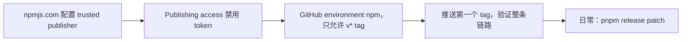

# 发布流程

network-portal 用 npm trusted publishing（受信发布）发布：GitHub Actions 用 OIDC 换一个短期凭据，自动附带 provenance（来源证明）。仓库里不存任何长期 npm token，发版也不用再输 2FA。

npm 要求包已经存在才能配置 trusted publisher。0.1.0 和 0.1.1 已在本机手动发过，所以直接从第一节的一次性配置开始。



## 一、一次性配置

### 1. 在 npmjs.com 配置 trusted publisher

以下命令需要 2FA，必须在自己的终端里跑（agent 的后台进程没有 TTY，会报 `EOTP`）：

```sh
npx npm@11 trust github network-portal --file release.yml --repo Adonis0123/network-portal --env npm --allow-publish --yes
npx npm@11 access set mfa=publish network-portal   # Require 2FA and disallow tokens
npx npm@11 trust list network-portal               # 复查
```

`npm trust` 要求 npm 11.5.1 或更新；本机 npm 较旧时用 `npx npm@11`。

等同的网页操作：打开 npmjs.com 上 `network-portal` 包的 **Settings**：

1. **Trusted Publisher** 选 **GitHub Actions**，填：
   - Organization or user：`Adonis0123`
   - Repository：`network-portal`
   - Workflow filename：`release.yml`（只填文件名，不带 `.github/workflows/`）
   - Environment name：`npm`
2. **Publishing access** 选 **Require two-factor authentication and disallow tokens**。这样任何 token 都发不了包，只剩 trusted publishing 和本人带 2FA 的手动操作。
3. 如果还有为这个包建的 automation token 或 granular token，在 **Access Tokens** 里删掉。

这几个值必须和仓库完全一致：workflow 文件名 `release.yml`、environment 名 `npm`、仓库 `Adonis0123/network-portal`。`package.json` 的 `repository.url` 也要指向同一个仓库，npm 校验 provenance 时会比对。

### 2. 在 GitHub 配置仓库

在 `Adonis0123/network-portal` 的 **Settings** 里：

1. **Environments** → `npm`：**Deployment branches and tags** 选 **Selected branches and tags**，只有一条 **Tag** 规则 `v*`。这样只有 `v*` tag 触发的 job 能用这个 environment。
   - 可选：**Required reviewers** 加上自己，每次发布前在 Actions 页面点一次批准。
2. 可选：**Rules → Rulesets** → **New tag ruleset**，Target 填 `v*`，勾选 Restrict creations、Restrict updates、Restrict deletions、Block force pushes，Bypass list 只加 Repository admin。这样别人推不了发布 tag，已发的 tag 也挪不动。
3. **Actions → General → Workflow permissions** 保持 **Read repository contents and packages permissions**。

第 1 项用 `gh` 命令做（已于 2026-11-24 配好）：

```sh
# 建 environment，部署规则用自定义规则
gh api -X PUT repos/Adonis0123/network-portal/environments/npm \
  --input - <<<'{"deployment_branch_policy":{"protected_branches":false,"custom_branch_policies":true}}'
# 加一条 tag 规则；不写 type=tag 时默认是 branch
gh api -X POST repos/Adonis0123/network-portal/environments/npm/deployment-branch-policies \
  -f name='v*' -f type=tag
```

复查：

```sh
gh api repos/Adonis0123/network-portal/environments/npm
gh api repos/Adonis0123/network-portal/environments/npm/deployment-branch-policies   # 应为 name v*、type tag
```

注意规则类型要是 `tag`。建成 `branch` 类型的 `v*` 也能通过上面第一条检查，但每次 tag 发布都会被 environment 拒绝。

### 3. 第一次走 trusted publishing

配置好后，推一个尚未发布的版本的 tag，验证 environment、OIDC 和 trusted publisher 整条链路。tag 打在的提交必须已经包含 `.github/workflows/release.yml` 并已推到 GitHub，否则推 tag 什么也不会触发。`main` 上的版本号还没发布时（例如 `package.json` 已是 0.1.2，npm 上最新是 0.1.1），直接给当前提交打 tag，不用再 bump：

```sh
git switch main
git pull --ff-only
git tag v0.1.2
git push origin v0.1.2
```

版本号已经发布过时，按第二节跑 `pnpm release patch`。发完按第二节的「发完检查」核对。

## 二、日常发版

前提：在 `main` 上，工作树干净，没有落后 `origin/main`。

```sh
git switch main
git pull --ff-only
pnpm release patch    # 新功能用 minor
```

`pnpm release`（`scripts/release.ts`）先确认在 `main`、工作树干净、没有落后 `origin/main`，然后：

1. `npm version <patch|minor> -m "🔖 chore(release): v%s"`：改 `package.json` 的版本号，提交，并打 `v<版本号>` tag；
2. `git push --follow-tags origin main`。

它自己不发布。推送 tag 后 `.github/workflows/release.yml` 的 `publish` job（environment `npm`，权限 `contents: read` 加 `id-token: write`，不用缓存）依次：

1. 安装固定版本的 npm 11.21.0，并确认不低于 11.5.1（trusted publishing 的最低要求）。
2. `pnpm install --frozen-lockfile --ignore-scripts`。
3. 确认 tag 等于 `v` 加 `package.json` 里的版本号，不一致就失败。
4. `pnpm lint`、`pnpm typecheck`、`pnpm test`、`pnpm build`，再跑 `pnpm leak-check`（构建后跑，连 `dist/` 一起扫）。
5. 版本已经在 npm 上就跳过发布；否则 `node scripts/pin-english-npm-readme.ts --publish`（内部是 `npm publish --access public`）。provenance 由 trusted publishing 自动生成，不传 token。

手动做也可以：`npm version patch` 加 `git push --follow-tags origin main`。

发完检查：

```sh
npm view network-portal version
npm view network-portal dist.attestations    # 有内容说明 provenance 已生成
npm view network-portal readmeFilename       # 应为 README.md，不是 README.zh-CN.md
```

npmjs.com 的包页面上也应该能看到 provenance 标记。

### 发版失败怎么办

| 现象 | 处理 |
|---|---|
| tag 和版本号不一致 | 删掉这个 tag（`git tag -d vX.Y.Z` 和 `git push origin :refs/tags/vX.Y.Z`；开了 tag ruleset 时远端删除要 admin 绕过），修好版本号后重新打 tag |
| job 卡在 environment 或报 `not allowed to deploy to npm` | environment `npm` 的部署规则不是 `v*` tag 类型，按第一节第 2 步修正 |
| `npm publish` 报 OIDC 或 `E404`/`E403`/`ENEEDAUTH` | 对照第一节第 1 步，检查 trusted publisher 的仓库名、workflow 文件名、environment 名是否完全一致，以及 npm 版本不低于 11.5.1 |
| lint、typecheck、test 或 leak-check 失败 | 修好后发一个新的 patch 版本，不要移动已有的 tag |

## 三、回滚

不用 `npm unpublish`。撤回会让依赖这个版本的人安装失败，而且同一个版本号以后再也不能用。

```sh
npm deprecate network-portal@0.1.3 "Broken: <一句话原因>. Use 0.1.4 or later."
```

然后修复问题，按日常流程发下一个 patch 版本。如果需要让 `latest` 暂时指回旧版本：

```sh
npm dist-tag add network-portal@0.1.2 latest
```

这两条命令都在本机执行，需要 2FA。

## 四、规则与已知问题

- 不在本机执行 `npm publish`，发布只走 tag 触发的 `release.yml`。
- 不创建长期 npm token，不在 workflow 里用 `pull_request_target`。
- workflow 里的 action 全部固定到完整 commit SHA，行尾注释版本号。
- 说明文件：npm 发布时从 `README.md` 和 `README.zh-CN.md` 里挑一个存进 registry 的 `readme` 字段，直接 `npm publish` 会挑中 `README.zh-CN.md`，npmjs.com 包页面就显示中文（0.1.0、0.1.1 都是这样）。`scripts/pin-english-npm-readme.ts --publish` 发布前把 `readme` 固定为 `README.md` 的内容、暂时移走 `README.zh-CN.md`，发完放回；`prepublishOnly`/`postpublish` 也挂了它。本地自查：`node scripts/pin-english-npm-readme.ts --check`。
